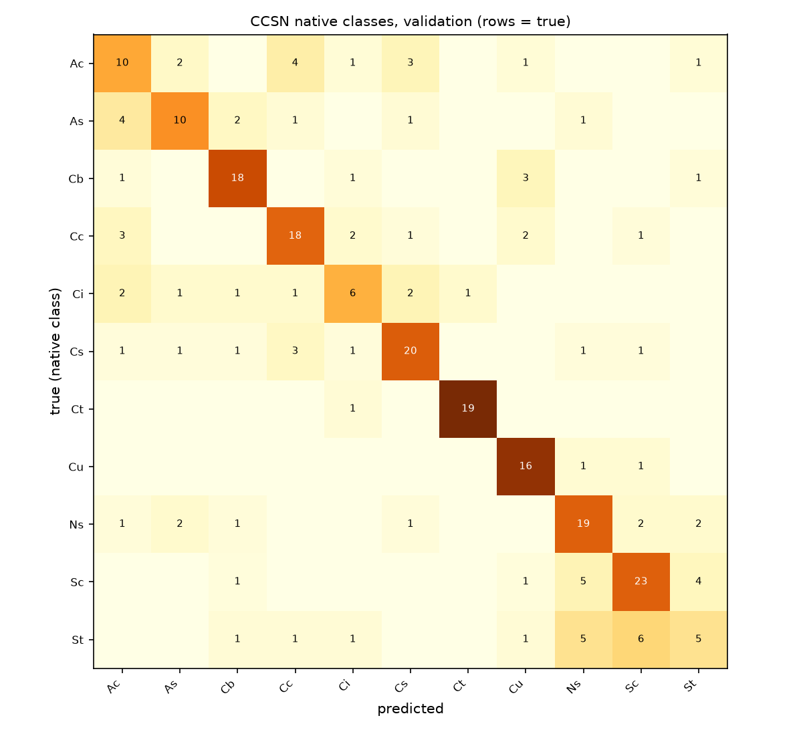
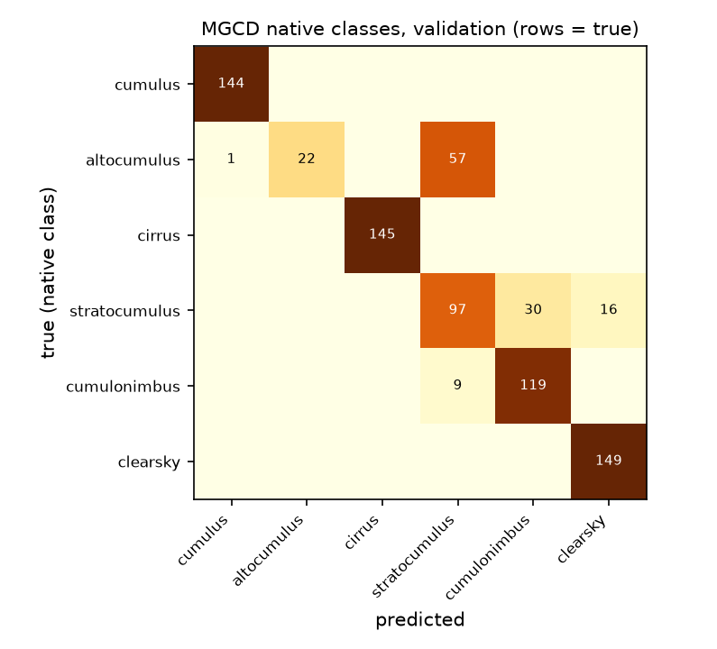
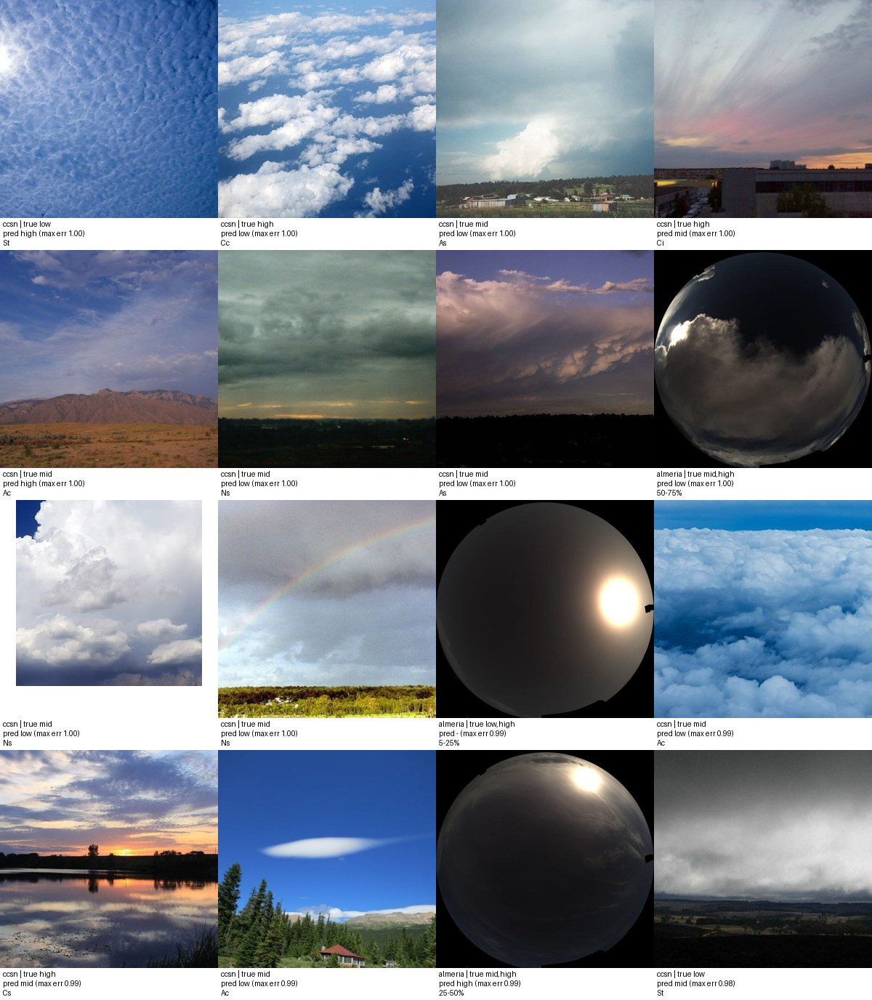

# Error analysis and shortcut re-check (P093)

Gate G4 global heads (`indomain_e2s`, EMA) on the validation rows; the locked test numbers are in P090. Run `20261105T135840Z_error_analysis_8ac9f81ffc`.

## Genus confusions (native classes)

| Dataset | Class | Recall | n | Most confused with (share) |
|---|---|---|---|---|
| CCSN | all | accuracy 0.643 | 255 | |
| CCSN | Ac | 0.455 | 22 | Cc (0.18) |
| CCSN | As | 0.526 | 19 | Ac (0.21) |
| CCSN | Cb | 0.750 | 24 | Cu (0.12) |
| CCSN | Cc | 0.667 | 27 | Ac (0.11) |
| CCSN | Ci | 0.429 | 14 | Cs (0.14) |
| CCSN | Cs | 0.690 | 29 | Cc (0.10) |
| CCSN | Ct | 0.950 | 20 | Ci (0.05) |
| CCSN | Cu | 0.889 | 18 | Ns (0.06) |
| CCSN | Ns | 0.679 | 28 | St (0.07) |
| CCSN | Sc | 0.676 | 34 | Ns (0.15) |
| CCSN | St | 0.250 | 20 | Sc (0.30) |
| MGCD | all | accuracy 0.857 | 789 | |
| MGCD | cumulus | 1.000 | 144 |  |
| MGCD | altocumulus | 0.275 | 80 | stratocumulus (0.71) |
| MGCD | cirrus | 1.000 | 145 |  |
| MGCD | stratocumulus | 0.678 | 143 | cumulonimbus (0.21) |
| MGCD | cumulonimbus | 0.930 | 128 | stratocumulus (0.07) |
| MGCD | clearsky | 1.000 | 149 |  |

| Dataset | Pair | Swapped share of the pair's rows | n | Counts |
|---|---|---|---|---|
| CCSN | St/Sc | 0.185 | 54 | 6 St->Sc, 4 Sc->St |
| CCSN | Ci/Cs | 0.070 | 43 | 2 Ci->Cs, 1 Cs->Ci |
| CCSN | As/Ns | 0.064 | 47 | 1 As->Ns, 2 Ns->As |

## Étage presence per source (exhaustive étage rows, threshold 0.5)

| Source | Étage | True rate | Predicted rate | Missed | Spurious |
|---|---|---|---|---|---|
| almeria | low | 0.429 | 0.583 | 0.111 | 0.354 |
| almeria | mid | 0.464 | 0.321 | 0.410 | 0.089 |
| almeria | high | 0.321 | 0.250 | 0.222 | 0.000 |
| almeria | exact set | 0.607 | | | |
| ccsn | low | 0.386 | 0.407 | 0.110 | 0.103 |
| ccsn | mid | 0.263 | 0.212 | 0.355 | 0.057 |
| ccsn | high | 0.267 | 0.267 | 0.175 | 0.064 |
| ccsn | exact set | 0.771 | | | |
| mgcd | low | 0.329 | 0.329 | 0.000 | 0.000 |
| mgcd | mid | 0.000 | 0.000 | 0.000 | 0.000 |
| mgcd | high | 0.331 | 0.331 | 0.000 | 0.000 |
| mgcd | exact set | 1.000 | | | |
| montenegro | low | 0.609 | 0.591 | 0.051 | 0.035 |
| montenegro | mid | 0.022 | 0.020 | 0.455 | 0.008 |
| montenegro | high | 0.057 | 0.102 | 0.241 | 0.062 |
| montenegro | exact set | 0.892 | | | |

## Sun glare

| Where | Quantity | Value | Clean |
|---|---|---|---|
| val (P088 corruption) | etage_f1: clean -> sun glare | 0.760 | 0.838 |
| val (P088 corruption) | genus_f1: clean -> sun glare | 0.656 | 0.703 |
| val (P088 corruption) | sky_miou: clean -> sun glare | 0.816 | 0.901 |
| val (P088 corruption) | clear_sky_cloud_fraction: clean -> sun glare | 0.467 | 0.292 |
| val (P088 corruption) | cbh_mae_m: clean -> sun glare | 745.508 | 605.748 |
| b0268 (adaptation days) | glare_fraction_strong_frames | 0.000 | - |
| b0268 (adaptation days) | glare_fraction_other_frames | 0.000 | - |

## Failure gallery

The validation frames with the largest étage error (exhaustive étage rows), true and predicted étages under each frame.

## Dataset identity from the model's features (P029 re-check)

| Features | Datasets | Accuracy | Chance | n test | Note |
|---|---|---|---|---|---|
| model pooled features (512-d) | eye2sky_cbh, mgcd, montenegro, ccsn, almeria, swimcat | 1.000 | 0.167 | 131 | balanced accuracy 1.000 |
| backbone CLS features (384-d) | eye2sky_cbh, mgcd, montenegro, ccsn, almeria, swimcat | 1.000 | 0.167 | 131 | balanced accuracy 1.000 |

Attention maps were not produced: the heads pool an 8 × 8 token grid through a learned attention pool whose weights are not stored at inference; the sky-parse mask is the per-pixel view the paper shows instead.
